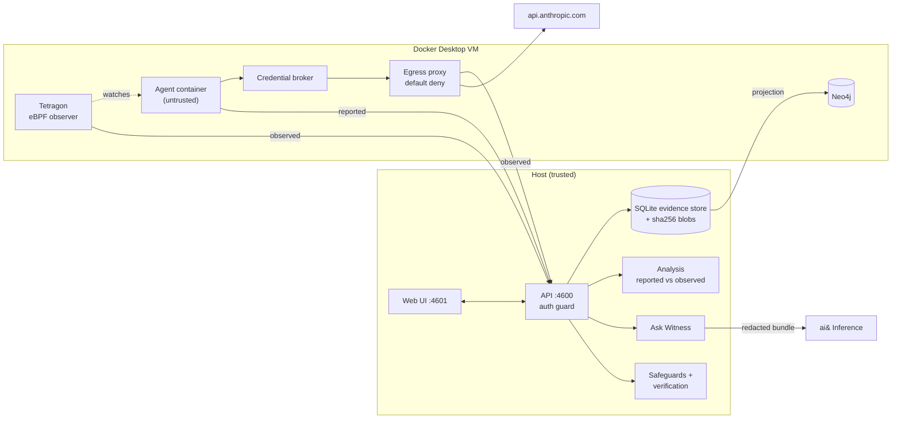

# Underwatch

**Independent, kernel-level evidence of what your AI coding agent actually did, compared with what it says it did,
turned into safeguards you can test.**

Underwatch runs Claude Code in a disposable container and observes it from outside: Tetragon (eBPF) in the
kernel, plus a default-deny egress proxy. It puts the agent's reported actions next to the observed ones, flags the
gaps, and lets you investigate them in a Neo4j evidence graph. **Ask Witness** (built on ai&) answers questions with
cited evidence. You can then turn an incident into a safeguard (a CLAUDE.md instruction, a permission rule, or a
regression test), approve the diff, and verify it with a fresh agent run.

> **Fixture data is synthetic.** The runs in `fixtures/runs/` are hand-authored for UI development and are badged
> FIXTURE everywhere. They are not captured telemetry.

<!-- Screenshots: replace placeholders before publishing -->
| | |
|---|---|
|  |  |
|  |  |
|  |  |

## Quickstart

### Prerequisites

- macOS with **Docker Desktop**. Validated on 4.57 with kernel 6.12.54. Other versions are untested.
- **Node ≥ 22.13** and **pnpm 9**.
- A Claude account for the supervised agent. Use a **dedicated** account.
- Optional: an **ai&** API key for Ask Witness and AI safeguard drafts. Without one, those features show as
  unavailable and safeguards fall back to deterministic templates.

### 1. Install

```sh
pnpm install
```

### 2. Build the container images

```sh
docker build -t kw-agent:2.1.302 docker/agent
docker build -t kw-egress-proxy:1 docker/egress-proxy
docker build -t kw-llm-broker:1 docker/llm-broker        # credential broker
docker pull quay.io/cilium/tetragon:v1.7.0
docker pull neo4j:community
```

<!-- VERIFY BEFORE PUBLISHING: final image tags, and whether a single `pnpm docker:build` / compose command replaces the lines above. -->

### 3. Claude Code token for the supervised agent

```sh
mkdir -p ~/.underwatch && chmod 700 ~/.underwatch
claude setup-token                       # copy the printed token
pbpaste > ~/.underwatch/claude-oauth-token   # or paste it into the file in an editor
chmod 600 ~/.underwatch/claude-oauth-token
```

The token is only ever read by the backend and passed to the agent's credential path. It is never written to the
repo or logged.

### 4. ai& key (optional)

Create `.env.local` in the repo root (gitignored):

```sh
AIAND_API_KEY=sk-...
# AIAND_MODEL=deepseek-ai/deepseek-v4-flash   # default
```

Neo4j connection settings come from `NEO4J_URI`, `NEO4J_USER`, `NEO4J_PASSWORD` and `NEO4J_DATABASE`.
<!-- VERIFY BEFORE PUBLISHING: Neo4j defaults (bolt 127.0.0.1:7697, container kw-neo4j) and how the password is provisioned. -->

### 5. Run

```sh
pnpm seed:fixtures   # optional: load the labeled synthetic runs
pnpm dev             # API on 127.0.0.1:4600, UI on 127.0.0.1:4601
pnpm open            # opens the UI with the local access token (the token is never printed)
```

### 6. Try the demo workspace

In the UI, open **Settings → Workspaces** and click **Create demo workspace**. This copies `fixtures/demo-repo-template/` to
`data/workspaces/demo-repo`, runs `git init` (isolated from your git config) and registers it. The repo contains a
**synthetic** `.env` (`KW_SYNTHETIC_SECRET=kw-test-0000`) and a harmless task (fix the "projct" typo, then keep
`python3 -m unittest` green). From a finding, use **Create safeguard → Approve → Run verification**.

Underwatch writes only to `CLAUDE.md` files inside a workspace you explicitly authorize, and only after you
approve a visible diff.

## Architecture



| Path | Purpose |
|---|---|
| `packages/schema` | Zod contract for every entity. Events carry a basis: `reported` / `observed` / `derived`. |
| `packages/observer-tetragon`, `docker/tetragon` | Kernel observer: exec, file open on watched paths, TCP connect, and an LSM file-open deny scoped to one container. |
| `packages/adapter-claude-code` | Captures stream-json, managed hooks and the transcript (all `reported`). |
| `packages/analysis` | Deterministic discrepancy rules and coverage. |
| `packages/graph` | Neo4j projection plus investigation queries (process ancestry, cross-run recurrence). |
| `packages/inference`, `packages/redaction` | ai& client (strict JSON schema, citation check, cache) and secret redaction. |
| `apps/server` | Fastify + `node:sqlite` API: auth, workspaces, investigations, safeguards, verification. |
| `apps/web` | React UI: Overview, Runs, Findings, Finding detail, Safeguards, Settings. |
| `docker/agent`, `docker/egress-proxy`, `docker/llm-broker` | The controlled execution environment. |
| `fixtures/` | Labeled synthetic runs and the demo repo template. |

<!-- VERIFY BEFORE PUBLISHING: adapter-claude-code, analysis and graph were being merged at draft time. Drop rows for anything that did not land. -->

## Documentation

- [`docs/PRD.md`](docs/PRD.md): product requirements
- [`docs/PRD-addendum-ask-witness.md`](docs/PRD-addendum-ask-witness.md): Ask Witness and safeguard generation
- [`docs/PRD-addendum-findings-modes.md`](docs/PRD-addendum-findings-modes.md): Findings update modes
- [`docs/ARCHITECTURE.md`](docs/ARCHITECTURE.md): architecture, observation boundary, verified vs unverified claims
- [`docs/ASK-WITNESS.md`](docs/ASK-WITNESS.md): Ask Witness implementation notes (auth, CLAUDE.md access)
- `docs/FINDINGS-MODES.md`, `docs/SECURITY-REMEDIATION.md`: <!-- link if present at publish time -->
- [`packages/observer-tetragon/README.md`](packages/observer-tetragon/README.md): what the kernel observer does and doesn't establish
- [`docs/submission/`](docs/submission/): hackathon submission, demo script, pitch

## Security model

- **Trust boundary.** The agent container is untrusted: uid 1000, all capabilities dropped, `no-new-privileges`,
  default seccomp, an internal-only network, and a disposable copy of the workspace. Observers (Tetragon, proxy,
  snapshots) and the evidence store sit outside it. The Docker socket is never mounted into a container.
- **Provenance comes from the channel, not the payload.** Anything the agent produces is `reported`, even when the
  host captured it. Findings of violations rest on independent (`observed`) evidence.
- **Local API.** Binds 127.0.0.1. Every route except health needs a bearer token (`data/auth-token`, mode 600).
  Host and Origin are allowlisted (against DNS rebinding), and mutating routes need a client header.
- **File writes.** Only `CLAUDE.md` inside an explicitly authorized workspace, only after diff approval. The write is
  a hash compare-and-swap, the before/after content is stored for rollback, and symlinks and `..` are refused.
- **AI.** Evidence is redacted before it reaches ai&. Model output is schema-validated, and citations are checked
  against the evidence bundle. The model never decides facts or verification outcomes.
- **Credentials.** The Claude token lives in `~/.underwatch/` (mode 600). The credential broker keeps the real
  token out of the agent container and gives the agent a per-run placeholder.
  <!-- VERIFY BEFORE PUBLISHING: broker wired into compose. Until then the token is in the agent's env; say so here. -->

## Limitations

- Not a safety guarantee or an EDR. Coverage is limited to the configured scope: processes in the agent container,
  file opens on watched paths, and proxy-level network decisions. **No event is not proof of no action.**
- A file open is not proof the content was read, used or sent. Bytes and TLS content are not recorded.
- Agent-reported data can be forged by the agent. It is used only to create discrepancies.
- A container escape gives root in the shared Docker VM. Agent reachability to in-VM listeners through the gateway,
  and DNS leakage via the proxy, are not yet verified.
- CLAUDE.md cannot block anything. Permission rules don't stop arbitrary subprocesses, because Claude Code's
  native sandbox can't run in the unprivileged container. Hook safeguards are not generated or tested.
- Verification results cover the scenario, model and policy tested. Agent behavior is non-deterministic.
- Validated only on Docker Desktop 4.57 / kernel 6.12.54 / Tetragon v1.7.0 / Claude Code 2.1.302 on macOS.

## License

TBD.
