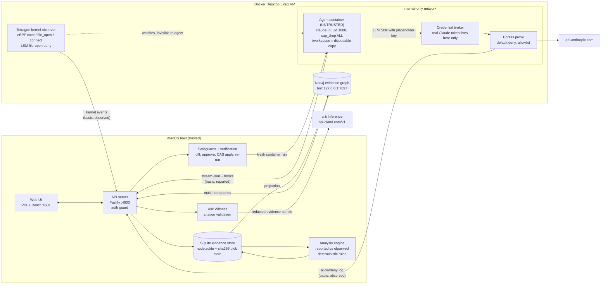

# Underwatch: Tokyo Agent Hackathon submission

> Status snapshot: 2026-10-17, about 11:45 JST. Several components were still being merged when this was written.
> Each claim below carries one of three tags: **Built**, **Staged** (code and tests exist in the staging copy but are
> not yet wired into the app), or **VERIFY BEFORE DEMO** (not yet shown end to end in this repo). Re-check this file
> before submitting.

## One-line pitch

**Your coding agent tells you what it did. Underwatch shows you what the kernel saw, explains the gap with cited
evidence, and turns the incident into a safeguard you can test.**

## Problem

AI coding agents read files, run shells and change repositories on their own. The record of a session is usually
the agent's own transcript, tool log and final summary. All of that is **reported by the agent**. When an agent says
"I didn't touch any secrets" but a subprocess ran `cat .env`, nothing in the agent's own record tells you so.

Developers need to know:

- what the agent attempted, and what actually happened;
- whether a permission rule really stopped the action, or the agent went around it (for example, Read denied, then
  `Bash: cat .env`);
- how to keep it from happening again, and proof that the fix works.

## What Underwatch does

1. **Supervises** a Claude Code run in a disposable, hardened Docker container.
2. **Observes independently**, from outside the container. Tetragon (eBPF) records processes and file opens in the
   kernel, and an egress proxy records network decisions. The agent cannot see or kill these observers.
3. **Captures the agent's own account** (stream-json, managed hooks, transcript) and labels all of it `reported`.
4. **Compares the two accounts** and raises findings such as "Read of `.env` was denied, but `cat .env` ran through
   Bash and succeeded, and the final report says no secrets were accessed."
5. **Investigates** in a Neo4j evidence graph: process ancestry from the kernel event back to the agent's tool call,
   and recurrence across runs.
6. **Explains** with **Ask Witness**, an ai&-powered investigator. Every answer must cite stored evidence IDs, and the
   server rejects answers whose citations do not resolve.
7. **Proposes safeguards** (a CLAUDE.md instruction, a permission rule, a regression test). Each one states plainly
   what it can and cannot enforce, and nothing is written until you approve a visible diff.
8. **Verifies** by re-running the scenario in a fresh container. The **security outcome** (was the prohibited action
   blocked?) and the **task outcome** (did the legitimate work still get done?) are reported separately.

## How it works

| Component | Where | Status |
|---|---|---|
| Agent container (`docker/agent`, Claude Code 2.1.302, non-root, managed settings mounted read-only) | Docker | **Built.** An authenticated headless run with hooks firing on tool calls succeeded (smoke run, 10:39 JST). |
| Egress proxy (`docker/egress-proxy`, tinyproxy, default deny) | Docker | **Built.** Allowed hosts return 200, others 403, and direct connections get ENETUNREACH (external targets only). |
| Credential broker (`docker/llm-broker`) | Docker | Code and unit tests exist. Not yet in `docker/compose.agent.yml`. **VERIFY BEFORE DEMO.** Until it is wired in, the OAuth token sits in the agent's environment (see Limitations). |
| Tetragon observer (`packages/observer-tetragon`, `docker/tetragon`) | Docker VM | **Built** as a package: parser tests run on real captured Tetragon JSON. Exec, file-open and connect hooks, plus an LSM file-open deny scoped to one container, were all exercised in the spike. Live wiring into runs: **VERIFY BEFORE DEMO.** |
| Hook / stream capture (Claude Code adapter) | Host | **Staged** (`packages/adapter-claude-code`). Being merged. |
| SQLite evidence store, API, auth guard | Host | **Built.** Bearer token in `data/auth-token` (mode 600), Host and Origin allowlist, and a required client header on mutating routes. |
| Analysis engine (`packages/analysis`) | Host | **Staged.** Being merged. |
| Neo4j graph (`packages/graph`) | Docker | **Staged.** It provides projection with an observed/reported/derived/inferred basis on every edge, `processAncestry`, `crossRunResourceRecurrence` and `findingNeighborhood`. The `kw-neo4j` container is running. `GET /api/findings/:id/graph` in this repo still returns 501 until "wire:neo4j" lands. **VERIFY BEFORE DEMO.** |
| ai& client (`packages/inference`) + redaction (`packages/redaction`) | Host | **Built.** OpenAI-compatible client, strict `json_schema` output, local Zod validation plus one repair pass, citation check, cache, secret redaction before every prompt. A live smoke call succeeded in staging. |
| Ask Witness (`apps/server/src/investigations`, `apps/web/src/components/askwitness`) | Host | **Built** (service and panel). Live ai& answer on fx-04: **VERIFY BEFORE DEMO.** |
| Safeguards + CLAUDE.md apply (`apps/server/src/safeguards`, `src/workspaces`) | Host | **Built.** Proposals come from ai& or from deterministic templates. Changes are applied with a hash compare-and-swap, the before/after content goes to the blob store, and rollback is available. Writes happen only inside an authorized workspace, by default a disposable demo repo. |
| Verification harness (`apps/server/src/verification`) | Host to Docker | **Built.** Without Docker, the image or the token, a run is recorded as **inconclusive**, never as passed. Live pass/fail on the demo scenario: **VERIFY BEFORE DEMO.** |
| Separate security vs task outcome | Schema + UI | Schema exists (`packages/schema/src/outcomes.ts`). Harness and UI wiring are in progress. **VERIFY BEFORE DEMO.** |
| Findings modes (Daily Digest / By Task / Current State) | UI | In progress. **VERIFY BEFORE DEMO.** |

## How we use the sponsor technologies

### Neo4j: the evidence graph

The question "how did this secret get read?" is a path question. A relational join cannot answer it without knowing
the path length in advance.

- **Every edge carries its basis.** Each relationship (`REPORTS`, `OBSERVED_AS`, `SPAWNED`, `TARGETS`, `VIOLATES`,
  `SUPPORTED_BY`, `CONTRADICTS`, `PROPOSED_AS`, `VERIFIED_BY`, `RECURRED_AS`, ...) is tagged
  `observed | reported | derived | inferred`. The UI never presents an inferred link as an observed one.
- **Multi-hop process ancestry.** Starting from the kernel's `file_open .env` event, `processAncestry` walks
  `SPAWNED*` edges: `cat` → `bash -c "cat .env"` → `claude` → the agent's reported `Bash` tool call. That single path
  is the core of the story: the kernel saw it, and this is the tool call that caused it. If no reported tool call
  correlates with the ancestry, the query says so explicitly instead of guessing.
- **Recurrence across runs.** `crossRunResourceRecurrence` finds findings in different runs whose observed events
  touched the same resource. Verification uses `RECURRED_AS` to decide whether a safeguard actually stopped the
  behavior.
- Runs on Neo4j Community in Docker on loopback only. The agent container has no credentials for it. Whether the
  agent has a network route to it is still being probed; see Limitations.

Status: **Staged**, wiring in progress. **VERIFY BEFORE DEMO.**

### ai&: Ask Witness and safeguard proposals

- **Ask Witness** answers investigator questions such as "Why did the permission rule not stop this?". The server
  builds an evidence bundle for the finding (events, evidence, policy, coverage gaps), runs secret redaction over it,
  and sends it to ai& through its OpenAI-compatible API at `https://api.aiand.com/v1`.
- **Citation validation.** The model must return structured JSON whose claims cite evidence IDs from the bundle.
  The server checks every citation and rejects or flags any that does not resolve. The UI renders citations as links
  to the evidence.
- **Safeguard proposals.** ai& drafts the CLAUDE.md instruction, permission rule or regression test. Underwatch
  attaches fixed, human-written "can / cannot enforce" text for each mechanism, so the model cannot overstate a
  safeguard. When ai& is unavailable, deterministic templates are used and labeled as such.
- **What ai& decides: nothing about facts.** Whether an event happened, whether a policy was violated and whether a
  safeguard passed verification all come from deterministic code over recorded evidence. ai& explains and drafts.
- **Model:** `deepseek-ai/deepseek-v4-flash` by default. ai&'s official strict-`json_schema` example uses this
  model, it is the cheapest in the catalog ($0.15 / $0.25 per 1M tokens), and reasoning can be switched off for
  latency. Override it with `AIAND_MODEL`. The client falls back to `json_object` mode if strict schema output is
  rejected. Responses are cached by bundle hash, prompt version and model.

## Real vs synthetic

| Item | Nature |
|---|---|
| `fixtures/runs/fx-01` … `fx-05` | **Synthetic, hand-authored.** Every record has `is_fixture: true`, and the UI shows a FIXTURE badge. They exist to demo and develop the UI. They are **not** captured telemetry. |
| `fixtures/demo-repo-template` | A synthetic demo repo. Its `.env` holds a fake secret (`KW_SYNTHETIC_SECRET=kw-test-0000`). |
| Live runs and verification runs | A **real Claude Code agent** (2.1.302, headless) in a disposable container against a copy of the demo repo, authenticated with a `claude setup-token` OAuth token. |
| Tetragon parser tests | Real captured Tetragon JSON from this machine, with synthetic secrets only. |
| ai& answers | Real ai& Inference calls. Without a key, the UI says "unavailable" and never shows a canned answer. |

## Limitations (honest)

- **Not a safety guarantee.** We observe a configured scope: processes in the agent container, file opens on watched
  paths, and network decisions at the proxy. A missing event does not prove an action never happened.
- **An open is not a read, and a read is not exfiltration.** We can show that `.env` was opened. We do not claim the
  content was used or sent.
- **Reported data can be forged** by the agent (stream-json, hook spool, transcript). We use it only to *create*
  discrepancies, never to clear one.
- **Credential exposure.** Until the credential broker is wired in, the Claude OAuth token is in the agent's
  environment and readable by its subprocesses. Use a dedicated account and rotate the token after the demo.
- **Container escape** gives root in the shared Docker VM, which would defeat Tetragon and the proxy.
- **In-VM reachability.** Whether the agent can reach listeners through the Docker bridge gateway (Neo4j, the API) is
  not yet verified. A proxy DNS leak for denied hostnames is also not yet probed.
- **CLAUDE.md is guidance, not enforcement.** Permission rules do not stop arbitrary subprocesses such as
  `python3 -c "open('.env')"`, because Claude Code's native sandbox cannot start in an unprivileged container. Only
  the kernel-level deny (Tetragon LSM) stops every process, and wiring it in as a one-click safeguard is
  **VERIFY BEFORE DEMO**.
- **Verification covers only the scenario it ran.** Agents are non-deterministic, and a pass covers that scenario,
  model and policy only.
- **Environment-specific.** Validated on Docker Desktop 4.57 / kernel 6.12.54 / Tetragon v1.7.0 on one Mac.
- Hook-based safeguards are shown as text only. They are not generated, applied or tested.

## Team and tech stack

- **Team:** _TBD: add names and roles._
- **Stack:** TypeScript pnpm monorepo, Node 22+. Fastify v5 with `node:sqlite`. Vite, React 19, React Router 7,
  TanStack Query and Tailwind v4. Zod 4 for the shared contract. Vitest.
- **Infrastructure:** Docker Desktop, Cilium Tetragon v1.7.0 (eBPF, BPF-LSM), tinyproxy, Neo4j Community
  (`neo4j-driver`), and Claude Code 2.1.302 headless.
- **Sponsors:** Neo4j (evidence graph) and ai& Inference (Ask Witness and safeguard drafting).
